Is it possible, with very limited resources and without using a GPS tracker, to determine whether you are at a specific location?

Is it possible to find out someone’s address by standing next to them for a few minutes (without asking for their address) and without using OSINT...?

## Your mission

Let me introduce you to Toto

He is 42 years old and used to work in Paris. He owns a funeral parlour, the address of which you know. Every day, he has a coffee with his friend Titi at the café opposite his business.

**You do not know Toto's address.**

Your mission, should you choose to accept it: to spy on Toto. You must be able to tell, in real time and 24 hours a day, whether Toto is at home or at his funeral parlour. That’s all you need to know...

You’re not part of an intelligence service, nor are you a member of the police force. You only have a budget of 10 euros.

You are not permitted to operate CCTV cameras.

No GPS tracker, otherwise it’s no fun, and there’d be no story.

## Disclaimer

This scenario is fictional. Any resemblance to real people or situations is purely coincidental.

I’m not a stalker...

## Proximity indicators: directed probe request


To complete your mission, you’ll go to Toto’s coffin shop and explain to him that your grandmother Monique has just passed away and that you’re there to organise her funeral.

This is just an excuse to spend a few minutes with Toto.

In your pocket, a simple ESP32 C5 that will passively capture all the Wi-Fi packets around you. The ESP32 will filter all these packets to retain only the directed probes


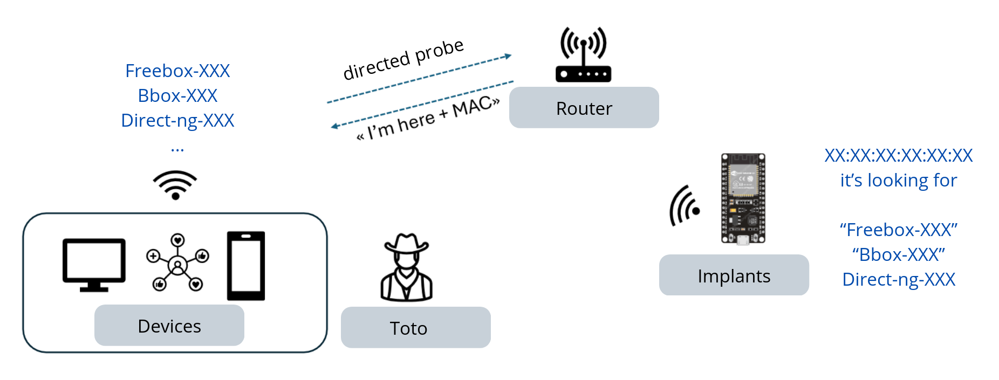{: width="850" .center}

A directed probe is, simply put, an 802.11 management frame. Among other things, it enables the device to:

- discover a specific network whose SSID is known to the client
- manage roaming to another access point.

Even if the device is already connected to an access point, it will, in most cases, continue to send directed probes.

The transmission frequency depends on a number of factors, including the operating system, but generally they are transmitted every few tens of seconds (often every 15 to 60 seconds, sometimes every few minutes).

The phone maintains a PNL (Preferred Network List) of the networks it has previously connected to. This often includes the SSIDs of:
- your broadband router (e.g. Livebox-, Freebox-, SFR_, Bbox-)
- your work router
- as well as public networks

A directed probe contains a number of elements. The most interesting one for us is the SSID of the access point that Toto’s phone is searching for.

So you now have an initial proximity indicator (IoP). If you see that same SSID somewhere else, it means that Toto’s phone is nearby and therefore probably close by

There is one condition: Wi-Fi must be enabled on Toto's phone.

Ideally, carry out the experiment twice in two different locations (for example, the café opposite Toto’s agency, where he’s a regular) so that you can filter out the SSIDs that aren’t relevant to our mission. It would be a shame to focus on the SSID belonging to Raymond and Huguette, the elderly couple who live above Toto’s agency.

After comparing the directed probes captured at Toto's agency and the Toto's bistro, we found the following:

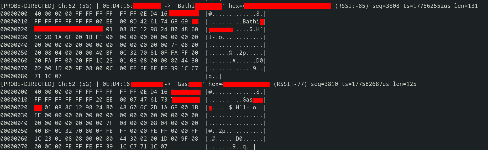{: width=800" .center}

This directed probe gives us two SSIDs from the same device (same MAC address). This is very useful: we can link both SSIDs to Toto. We now have our IoP

### Directed probe in detail

All 802.11 Wi-Fi frames have a 2-byte Frame Control field in the 802.11 MAC header.
To put it very simply, the first bytes of a management frame begin with:

```
bits 0-1 : 00 ---> version
bits 2-3 : 00 ---> type 0 = management
```

The next four bits then allow us to determine the function:

```
bits 4-7 : 0100 ---> Probe Request
```

Using this methodology, we could also distinguish between other types of frames:

```
type (bits 2-3) : 
00 ---> management
01 ---> control
10 ---> data
11 ---> extension
```

Wi-Fi management frame (directed probe): 

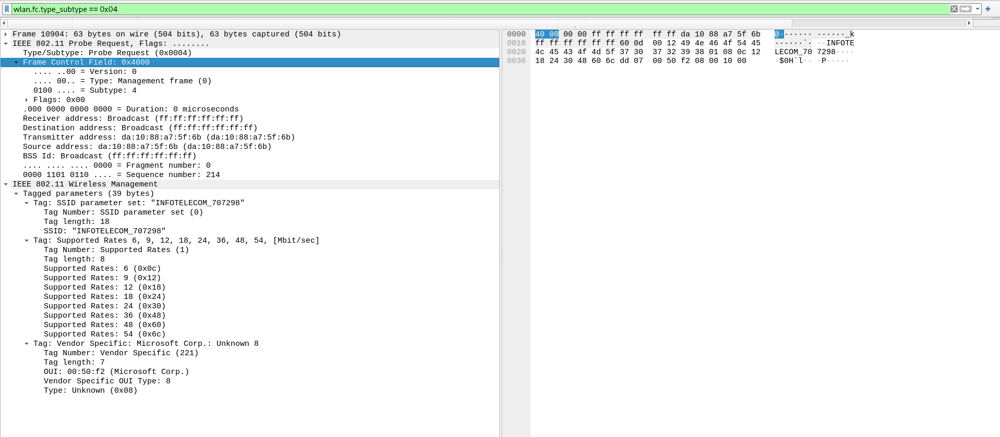{: width="1000" .center}


Wi-Fi management frame (beacon): 

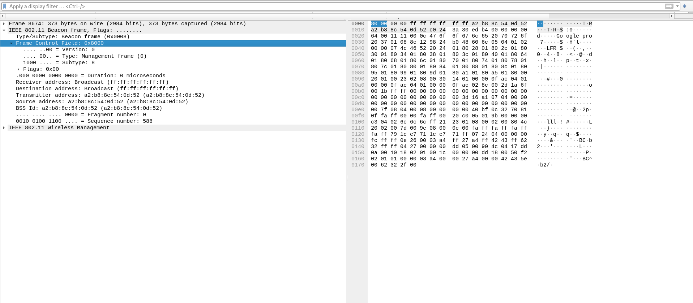{: width=600" .center}

For example, here, if we look at the directed probe (DP) associated with our target:

```
┌────────┬───────────────────┬───────────────────┬────────────────────────────────────────────────┐
│ Offset │      Bytes        │      Field        │                      Value                     │
├────────┼───────────────────┼───────────────────┼────────────────────────────────────────────────┤
│ 0x00   │ 40 00             │ Frame Control     │ 0x0040: management, subtype 4 = Probe Request  │
│ 0x0A   │ 0E D4 16 XX XX XX │ Address 2 (source)│ MAC source                                     │
│ 0x18   │ 00 0D             │ SSID IE           │ ID 0, length 13                                │
│ 0x1A   │ 42 61 74 68 69 …  │ SSID              │ "Bathi…"                                       │
└────────┴───────────────────┴───────────────────┴────────────────────────────────────────────────┘
```

We then find the SSID at offset 0x1A. This is the element we’re most interested in. Sometimes it’s not present: the length at offset 0x18 is 0x00. In that case… RIP to our IoP.

**Capabilities**

There are other interesting fields, such as ‘VHT Capabilities’, ‘Vendor Specific’ and ‘Extended Capabilities’, which can help improve the fingerprint, as this information relates to the device sending the directed probe.

This information can sometimes help us distinguish between two phones of different makes or models when we have two probes with two source MAC addresses and the same SSID.

Some examples of interesting information to look for in a DP:

- **HT Capabilities** : indicates support for 802.11n (Wi-Fi 4).
- **VHT Capabilities** : MCS/NSS define the modulation/coding and the number of spatial streams. These values may vary depending on the chipset and firmware.
- **Vendor Specific** : contains a vendor ID which can sometimes tell us the manufacturer. It is very often used to distinguish a PC from a smartphone.
- **HE 6 GHz Band Capabilities** : indicates support for 6 GHz (Wi-Fi 6E).
- **EHT Capabilities** : indicates Wi-Fi 7 (802.11be).
- **Multi-Link** : indicates support for MLO (Wi-Fi 7).

In our case, we have:

```
┌────────┬───────────────────────────────────────────┬───────────────────────────────────┐
│ Offset │                  Bytes                    │              Field                │
├────────┼───────────────────────────────────────────┼───────────────────────────────────┤
│ 0x51   │ BF 0C 32 70 80 0F FE FF 00 00 FE FF 00 00 │ VHT Capabilities                  │
│ 0x53   │ 32 70 80 0F                               │ VHT Capabilities Info             │
│ 0x57   │ FE FF                                     │ Rx MCS Map                        │
│ 0x59   │ 00 00                                     │ Rx Highest Supported Long GI Rate │
│ 0x5B   │ FE FF                                     │ Tx MCS Map                        │
│ 0x5D   │ 00 00                                     │ Tx Highest Supported Long GI Rate │
└────────┴───────────────────────────────────────────┴───────────────────────────────────┘
```

Although we cannot identify the device from this, we can say, thanks to

```
HE PHY Capabilities — 44 30 02 00 1D 00 9F 08 00 0C 00
```

that the device implements the following features (whose names are utterly unpronounceable, thanks, Claude...)

> Interpretation: 5 GHz 40/80 MHz, LDPC, NDP 4x LTF, SU beamformee up to 8 STS, codebooks 42/75, trigger feedbacks, PPE thresholds, and 1024-QAM on resource units smaller than 242 subcarriers. No 160 MHz, no 80+80, no STBC, no DCM, no MU-MIMO.

These values depend on the chipset; consequently, they may vary from one phone to another, and this can strengthen our fingerprint.
**Important information:**

- MAC randomisation has been used for several years. It works differently depending on the OS, version and frame type. For the SSID IoP, this does not matter: the SSID does not change for a given network. However, the MAC address can help link several frames together.

- If we’re lucky, our target is wearing a smartwatch; it’s highly likely that it doesn’t use MAC randomisation, so we can obtain a more accurate fingerprint.

{: width="900" .center}

## Finding Toto's address

We’ve achieved half of our goal; we’re now able to determine whether Toto is in a specific location. However, there’s one thing we’re still missing: Toto’s address.

The good news is that there’s a technical solution developed by wardriving enthusiasts: WiGLE.

<https://wigle.net/>

Using their API, you can often get an approximate location for the SSID, based on the GPS coordinates where it was spotted by someone wardriving. You’ll receive the GPS coordinates along with the date and time of its last sighting.

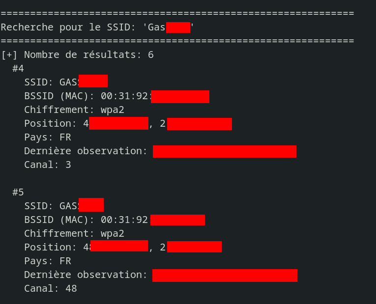{: width="600" .center}

Because the MAC address is not randomised, we can also identify the router manufacturer (OUI), but not necessarily the exact model.

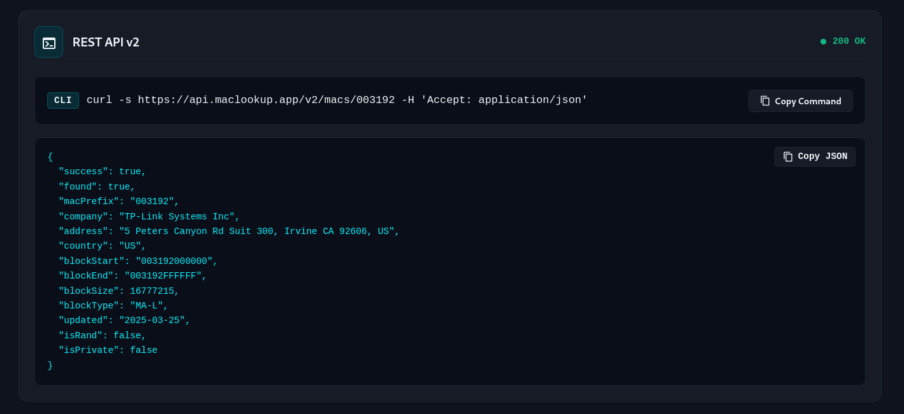{: width="850" .center}

**Please note that there are many false positives: we often see inconsistent history with the SSID appearing in numerous locations. Sometimes we find nothing. Either because the SSID was never captured, or because a request has been made to remove it from the WiGLE database.**

**The address is not always very precise, but that does not stop us. Even without the exact address, we can often narrow it down to an area, a street or a neighbourhood, and then place implants in likely places the target passes through might pass through.**

So it does not always work.

## Designing and fitting our tracking devices

**An update on the situation**

We have found the address where our target lives. We have found some interesting proximity indicators (IoPs). The next stage of our mission is now to install implants near Toto’s flat and near his agency.

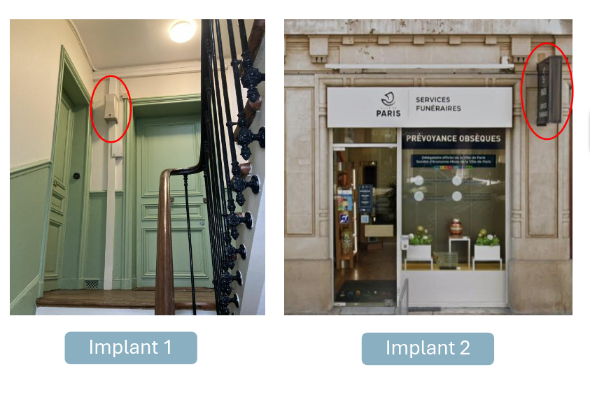{: width="600" .center}

Why here? Because it’s easy to hide things here and retrieve them later…

We can use our ESP32 with a small 4G module and an external battery. The implant will will be to passively capture all Wi-Fi management frames, keep only the directed Probe Requests, and send them to us.


From our workstation, we will apply further filtering to focus solely on the IoPs from our target. We can also carry out this filtering directly on the ESP32. Both options are valid.

In order to receive information in real time on our PC, one of the simplest solutions to implement is MQTT.


**Message Queuing Telemetry Transport**
MQTT (Message Queuing Telemetry Transport) is a lightweight publish/subscribe messaging protocol, typically running over TCP/TLS. Clients do not send messages directly to one another: they go via a broker.
The broker:
- receives messages published by clients 
- filters them by topic 
- redistributes them to clients subscribed to that topic 
- manages sessions, subscriptions, retained messages and QoS levels.


**mTLS and AWS IoT Core**
mTLS (mutual TLS) means that both parties present a certificate:
- the server proves its identity to the client
- the client proves its identity to the server.
  
In AWS IoT Core:
1. The client verifies the server’s certificate against the Amazon Root CA.
2. The client presents its X.509 certificate and private key.
3. AWS IoT Core verifies that the client certificate is signed by a trusted CA.
4. An IoT policy attached to the certificate then authorises the MQTT actions


**Requirements for our implants**

It is important to distinguish between secrets and MQTT parameters:
- Amazon Root CA
- Device certificate
- Private key
- AWS IoT endpoint, Client ID, Topic

We therefore need to install a set of certificates and a private key into the ESP32’s flash memory. And that’s where the problems begin.

**Device impersonation**

If someone recovers our implant and extracts the flash memory (if it is not encrypted), they can very easily obtain the mTLS secrets and impersonate our ESP32.

Depending on the ESP32’s configuration, we can extract the firmware via:
- a USB-UART cable
- UART pins
- JTAG, which is enabled by default. 

Here, we were able to extract the flash memory very easily via a USB cable.


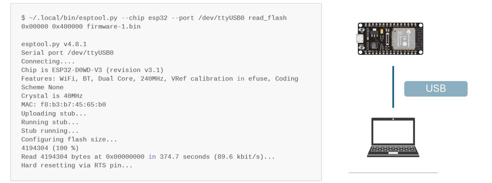{: width="800" .center}

For JTAG, OpenOCD with the FT232H is more than enough. You can do some really interesting things with JTAG. For example, dumping the RAM of my ESP32, even with flash encryption and retrieving mTLS secrets… Just saying…

<https://github.com/openocd-org/openocd>

Ideally, you should therefore enable at least the following:
- flash encryption 
- secure boot 
- disabling JTAG via eFuse
- if possible, disabling the UART download

**On the PC**

Our ESP32 is now sending IoP data via MQTT. On the PC, we can use an MQTT client or the AWS IoT Device SDK v2 to receive the packets.

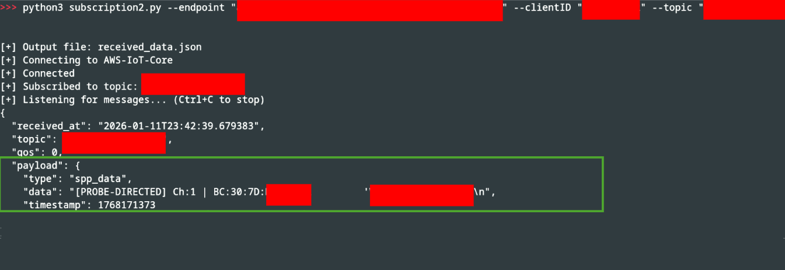{: width="800" .center}

## What could possibly go wrong? 

**A few best practices**

We’re working in cybersecurity, so we might as well configure AWS permissions and policies correctly.
AWS IoT Core defines several policy actions. The four main MQTT actions are:
- **iot:Connect**: establish the MQTT session 
- **iot:Publish**: publish to a topic 
- **iot:Subscribe**: subscribe to a topic filter 
- **iot:Receive**: receive messages from a subscription

So:
- **ESP32**: iot:Connect + iot:Publish 
- **PC**: iot:Connect + iot:Subscribe + iot:Receive 

Many tutorials add iot:* to * ‘just to make it work’. This is bad practice: it turns a compromised implant into a device capable of widespread publishing, or even subscribing, when it doesn’t need to be.

This YouTube channel gives some very bad advice.


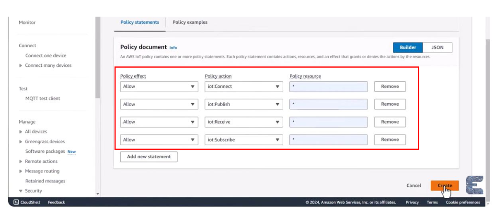{: width="800" .center}

<https://www.youtube.com/watch?v=59xppRDOEZE>

This isn’t the only problematic resource, and LLMs often behave in the same way if you don’t specify things correctly (sometimes even when you do ask them).

Ideally, you should have one identity per role:
- one identity for the ESP32, with a ‘publish-only’ policy + Connect
- one identity for the PC, with a ‘subscribe’ + ‘receive’ + Connect policy.

**Some forensics**

Another point not to be overlooked...

If you are using the Arduino IDE or ESP-IDF (which I wouldn’t recommend), the ESP32 stores your Wi-Fi credentials in the NVS by default. The big advantage (or disadvantage, depending on your point of view) is that if you change the firmware or your Wi-Fi credentials, the old ones remain stored until you completely erase the flash...

Once the flash has been extracted, whether you use ESP-IDF or the Arduino IDE, it’s very easy to extract the partition table and the NVS using the following tool:

<https://github.com/BlackVS/esp32knife>

This will reveal the partition table. By default, it is located at offset 0x8000 when using ESP-IDF. It could even be extracted manually...

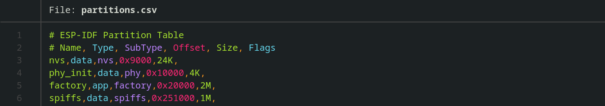{: width="600" .center}

Once you have the partition table, you can extract the NVS and retrieve the Wi-Fi credentials that are stored by default.

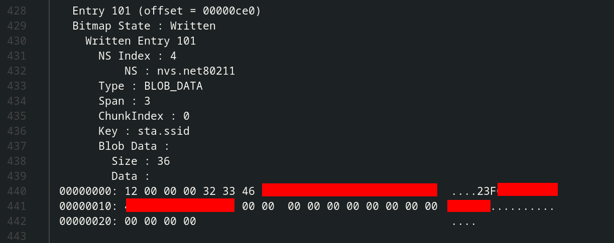{: width="700" .center}

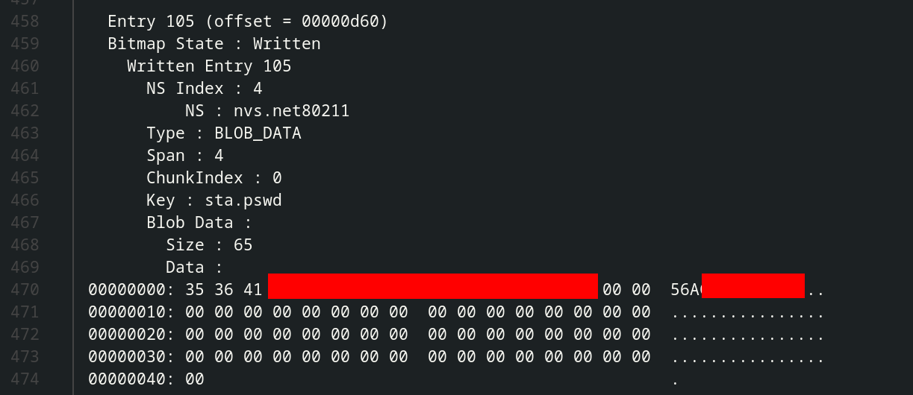{: width="700" .center}

Where there’s a Wi-Fi SSID, there’s WiGLE, and it would be bad if your target were to find the address where the implant was developed...

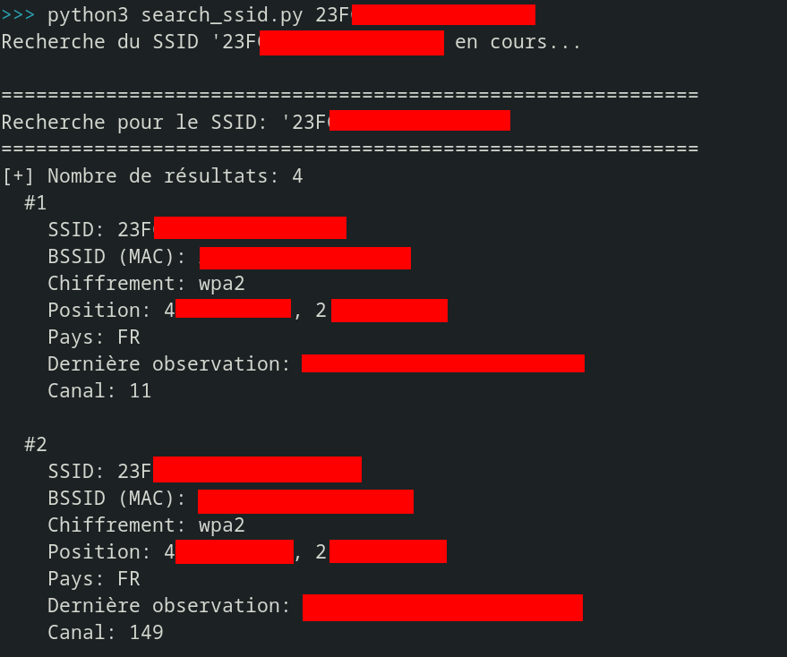{: width="600" .center}

If, unfortunately, our ESP32 is stolen and its new owner or the police manage to extract the secrets, they will be able to impersonate the implant and publish false data on the authorised topics. This could become a problem.

You might say that if someone can just send fake data to sabotage our mission, that is a real problem, and you’d be right. But hey, we’re dealing with cybersecurity here, so a minimum, and I mean a bare minimum, of best practices is better. Even if there’s plenty more we could add...

## Conclusion

**First question: is it easy to tell if someone is at a specific location without a GPS tracker?**

Yes. With a simple ESP32, a few minutes on site and Wi-Fi enabled on the target’s phone, you can capture directed probes. If you see an SSID specific to Toto (his home router, his office router, etc.), that is a strong sign he is nearby.. Seeing the same SSIDs again at another place makes it stronger

This isn’t conclusive proof, as several devices may share the same SSID, but it’s often enough to tell whether our target has been in the area.

**Second question: can we find out their address by staying near them for a few minutes, without using OSINT?**

It is more difficult.. WiGLE can sometimes give an exact address, but often provides an approximate location and sometimes completely wrong. The best approach is to keep only the most recent WiGLE results and, ideally, have a history that all points to the same place.