# Comment espionner Toto ? 

Savez-vous qu'il est possible, avec très peu de moyens et sans utiliser de tracker GPS, de savoir si vous êtes à un endroit précis ?

Savez-vous qu'il est parfois possible de retrouver l'adresse d'une personne en restant quelques minutes à côté d'elle (sans lui demander son adresse) et sans utiliser d'OSINT... ?

## Votre mission

Je vous présente Toto

Il y a 42 ans, il travaillait à Paris. Il possède une agence funéraire dont vous connaissez l'adresse. Il prend tous les jours un café avec son ami Titi dans le café en face de son adresse.

**Vous ne possédez pas l'adresse de Toto.**

Votre mission, si vous l'acceptez : espionner Toto. Vous devez être capable, en temps réel et 24 h/24, de dire si Toto se trouve chez lui ou dans son agence funéraire. C'est tout ce que vous devez savoir...

Vous ne faites pas partie d'un service de renseignement, vous n'appartenez pas aux forces de l'ordre. Vous avez seulement 10 euros de budget.

Vous n'avez pas le droit d'exploiter de caméras de surveillance.

Pas de tracker GPS, sinon ce n'est pas marrant, et il n'y a pas d'article.

## Disclaimer

Ce scénario est fictif. Toute ressemblance avec des personnes ou des situations existantes est purement fortuite.

Je ne suis pas un stalker...

## Indicateurs de proximité - directed probe

Pour remplir votre mission, vous allez vous rendre dans la boutique de cercueils de Toto et vous allez lui expliquer que votre grand-mère Monique vient de mourir et que vous êtes là pour organiser ses obsèques.

Ceci est un prétexte pour passer quelques minutes avec Toto.

Dans votre poche, une simple ESP32 qui va capturer passivement tous les paquets Wi-Fi autour de vous. L'ESP32 va filtrer tous ces paquets pour ne garder que les Probe Requests dirigées.

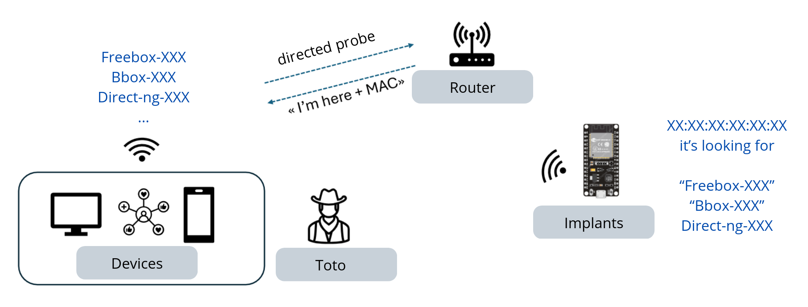{: width=500" .center}

Une Probe Request dirigée est une trame de management 802.11, en clair. Elle sert entre autres au device à :

- découvrir un réseau précis dont le client connaît le SSID
- gérer le roaming vers un autre AP.

Même si le device est déjà connecté à un AP, il continuera la plupart du temps à envoyer des directed probe.

La fréquence d'émission dépend de nombreux paramètres, dont l'OS, mais en général elles sont émises toutes les quelques dizaines de secondes (souvent 15 à 60 s, parfois plusieurs minutes).

Le téléphone conserve une PNL (Preferred Network List) les réseaux auxquels il s'est déjà connecté. Elle contient souvent le SSID:
- de votre box (box : Livebox-, Freebox-, SFR_, Bbox-…)
- routeur de votre travail
- mais aussi des réseaux publics.

À  l'intérieur d'une directed probe, on retrouve un certain nombre d'éléments. Le plus intéressant pour nous est le SSID du point d'accès recherché par le téléphone de Toto

Vous avez donc un premier indicateur de proximité (IoP). Si vous voyez à un autre endroit ce même SSID, alors cela veut dire que le téléphone de Toto se trouve à proximité et donc probablement à proximité

Une seule condition, que le Wi-Fi soit allumé sur le téléphone de Toto. 

Idéalement, faites l'expérience deux fois à deux endroits différents (par exemple le café en face de l'agence de Toto, où il a ses habitudes) afin de faire un diff des SSID non utiles pour notre mission. Ce serait dommage de se focaliser sur le SSID de Raymond et Huguette, le couple de personnes âgées qui habitent au-dessus de l'agence de Toto.

Après avoir fait un différence des directed probes récupérées dans l'agence de Toto et le bistrot d'à côté, nous avons trouvé ceci :

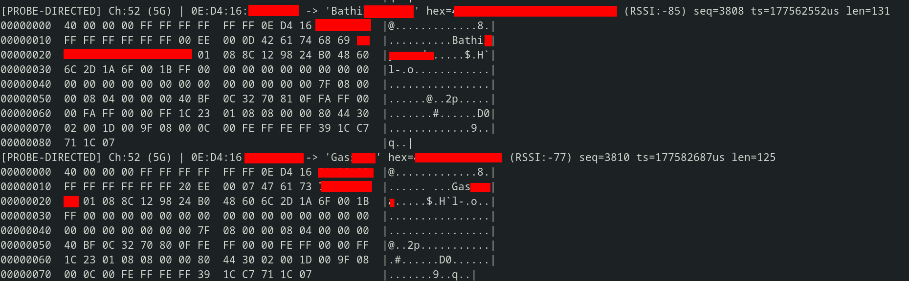{: width=500" .center}


Cette directed probe, nous donne deux SSID depuis le même équipement (même MAC). C'est donc une information qui est très intéressante. Nous pouvons donc relier ces deux SSID à Toto. Nous avons donc notre IoP

### Directed probe en détails

Toutes les trames Wi-Fi 802.11 ont un Frame Control de 2 octets dans le header MAC 802.11.
Pour faire très simple, les premiers octets d'une trame de management commencent par :

```
bits 0-1 : 00 ---> version
bits 2-3 : 00 ---> type 0 = management
```

Ensuite les 4 prochains bits nous permettent de déterminer la fonction

```
bits 4-7 : 0100 ---> Probe Request
```

Avec cette méthodologie, nous pourrions aussi différencier les autres types de trames :

```
type (bits 2-3) : 
00 ---> management
01 ---> control
10 ---> data
11 ---> extension
```

Trame de management (directed probe)

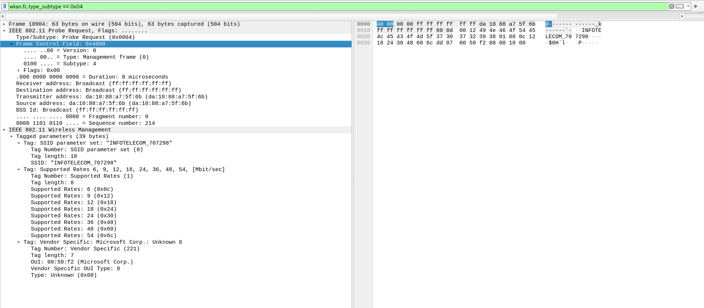{: width=500" .center}

Trame de management (beacon)

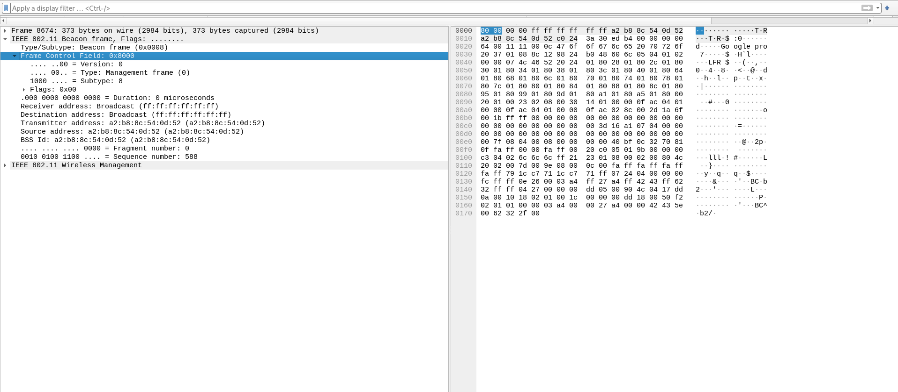{: width=500" .center}

Par exemple ici, si nous reprenons la DP associée à notre target :

```
┌────────┬───────────────────┬───────────────────┬────────────────────────────────────────────────┐
│ Offset │ Octets            │ Champ             │ Valeur / preuve                                │
├────────┼───────────────────┼───────────────────┼────────────────────────────────────────────────┤
│ 0x00   │ 40 00             │ Frame Control     │ 0x0040 Probe Request Directed                  │
│ 0x0A   │ 0E D4 16 XX XX XX │ Address MAC       │ MAC source                                     │
│ 0x18   │ 00 0D             │ SSID IE           │ ID 0, longueur 13                              │
│ 0x1A   │ 42 61 74 68 69 …  │ SSID              │ "Bathi…"                                       │
└────────┴───────────────────┴───────────────────┴────────────────────────────────────────────────┘
```

Nous retrouvons ensuite le SSID à l'offset 0x1A. C'est cet élément qui nous intéresse le plus. Parfois, il n'est pas présent : la longueur à l'offset 0x18 vaut 0x00. Dans ce cas-là... RIP pour notre IoP.

**Capabilities**

Il y a d'autres champs intéressants comme VHT Capabilities, Vendor Specific, Extended Capabilities, qui peuvent permettre d'améliorer le fingerprint, car ces informations sont liées au device qui envoie la directed probe

Ces infos peuvent parfois nous aider à différencier deux téléphones de marques ou de versions différentes quand on a deux DP avec deux MAC sources et le même SSID.

Quelques exemples d'informations qu'il est intéressant de trouver dans une DP:

- **HT Capabilities** : indique le support 802.11n (Wi-Fi 4).
- **VHT Capabilities** : MCS/NSS définissent la modulation/codage et le nombre de flux spatiaux. Ces valeurs peuvent varier selon le chipset et le firmware.
- **Vendor Specific** : contient un IE vendor qui peut parfois nous indiquer le constructeur. Il est très souvent utilisé pour différencier un PC d'un smartphone.
- **HE 6 GHz Band Capabilities** : indique un support 6 GHz (Wi-Fi 6E).
- **EHT Capabilities** : indique Wi-Fi 7 (802.11be).
- **Multi-Link** : indique le support MLO (Wi-Fi 7).

Dans notre cas, nous avons:

```
┌────────┬───────────────────────────────────────────┬───────────────────────────────────┐
│ Offset │ Octets                                    │ Champ                             │
├────────┼───────────────────────────────────────────┼───────────────────────────────────┤
│ 0x51   │ BF 0C 32 70 80 0F FE FF 00 00 FE FF 00 00 │ VHT Capabilities                  │
│ 0x53   │ 32 70 80 0F                               │ VHT Capabilities Info             │
│ 0x57   │ FE FF                                     │ Rx MCS Map                        │
│ 0x59   │ 00 00                                     │ Rx Highest Supported Long GI Rate │
│ 0x5B   │ FE FF                                     │ Tx MCS Map                        │
│ 0x5D   │ 00 00                                     │ Tx Highest Supported Long GI Rate │
└────────┴───────────────────────────────────────────┴───────────────────────────────────┘
```

Même si nous ne pouvons pas ici savoir de quel device il s'agit, nous pouvons dire, grâce à

```
HE PHY Capabilities — 44 30 02 00 1D 00 9F 08 00 0C 00
```

que le device implémente les features suivantes (dont les noms sont complètement imbuvables, merci Claude...)

> Interprétation : 5 GHz 40/80 MHz, LDPC, NDP 4x LTF, SU beamformee jusqu’à 8 STS, codebooks 42/75, feedbacks trigger, PPE thresholds, et 1024-QAM sur RU < 242 tones. Pas de 160 MHz, pas de 80+80, pas de STBC, pas de DCM, pas de MU-MIMO.

Ces valeurs dépendent du chipset par conséquent, elles peuvent changer en fonction des téléphones et cela peut renforcer notre fingerprint

**Informations importantes:**

- La randomisation MAC est utilisée depuis plusieurs années, avec des comportements différents selon l'OS, la version et le type de trame : Dans notre cas, on s'en fiche pour l'IoP SSID, car la trame contient le SSID et celui-ci ne change pas pour un réseau donné. En revanche, la MAC peut servir à relier plusieurs trames entre elles.

- Si nous avons de la chance, notre cible porte une montre connectée, il est très probable qu'elle n'implémente pas de randomisation MAC, nous pouvons donc avoir un fingerprint plus précis.

{: width=500" .center}

## Retrouver l'adresse de Toto

Nous avons rempli la moitié de notre objectif, nous sommes en mesure de déterminer si Toto se trouve dans un lieu précis. En revanche, il nous manque quelque chose, l'adresse de Toto

Bonne nouvelle, il existe une solution technique alimentée par les amateurs de Wardriving : WiGLE

https://wigle.net/

Avec leur API, vous pouvez assez souvent localiser approximativement le SSID, via les coordonnées GPS où il a été vu par quelqu'un qui fait du Wardriving. Vous obtenez les coordonnées GPS ainsi que la date et l'heure de la dernière apparition.

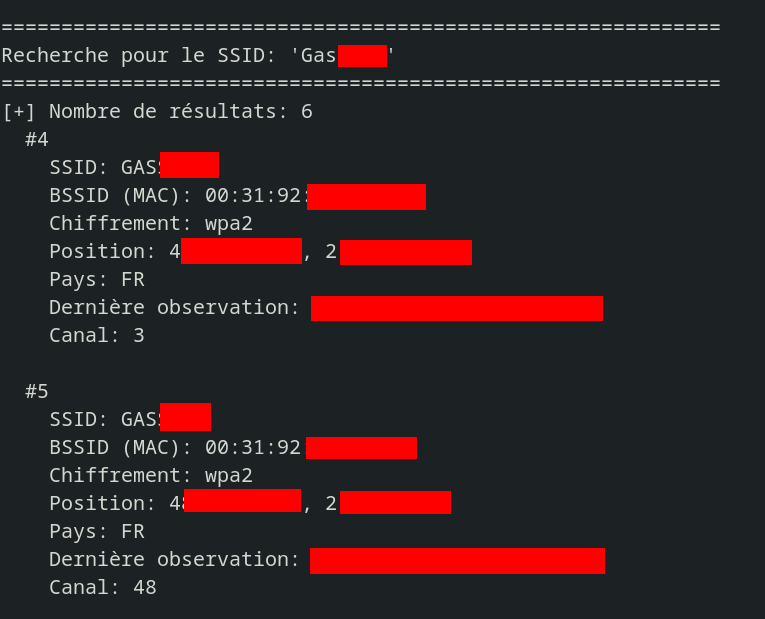{: width=500" .center}

Petit bonus ici : l'adresse MAC n'étant pas randomisée, en plus de localiser le réseau, nous avons aussi le constructeur du routeur (OUI), mais pas nécessairement le modèle exact.

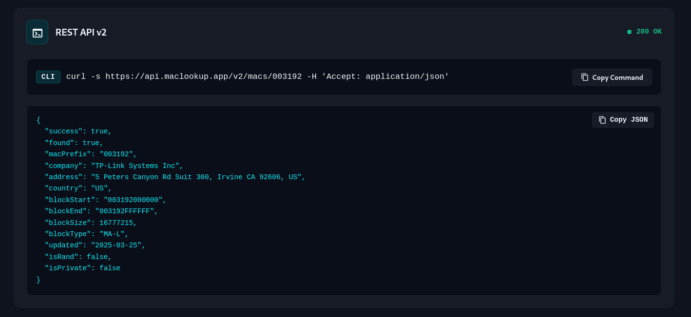{: width=500" .center}

**Attention, il y a de nombreux faux positifs : on observe souvent un historique incohérent avec des apparitions à de nombreux endroits. Parfois aussi, nous ne trouvons rien... Soit parce que le SSID n'a jamais été capturé, soit parce qu'une demande pour le retirer de la base WiGLE a été faite.**

**L'adresse n'est pas toujours extrement précise mais ce n'est pas bloquant pour notre mission. Même sans l'adresse exacte, on peut souvent déduire une zone, une rue ou un quartier, puis placer des implants sur des points de passage potentiels de la cible.**

Ce n'est donc pas une solution magique.

## Foutre des implants et terminer notre mission

**Un point sur la situation**

Nous avons trouvé l’adresse où habite notre target. Nous avons trouvé des IoP intéressants. La suite de notre mission consiste maintenant à installer des implants près de l’appart de Toto et près de son agence.

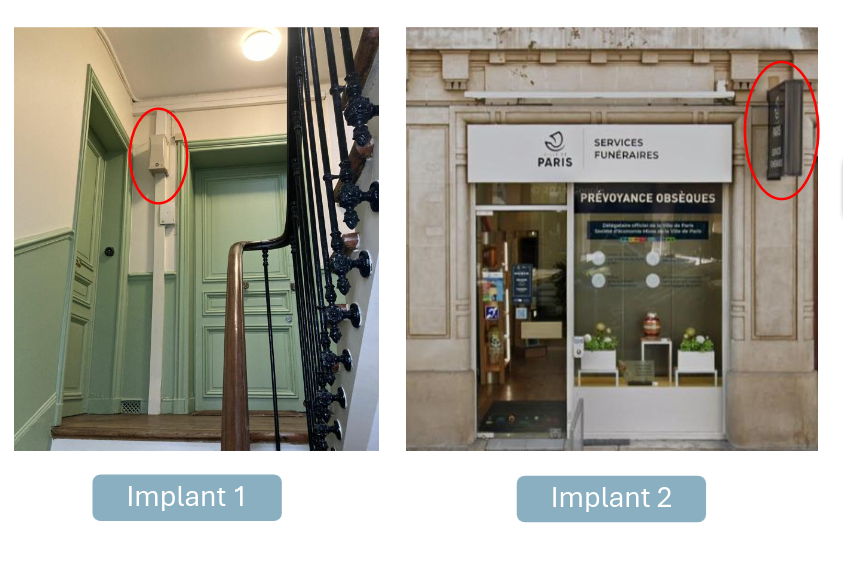{: width=500" .center}

Pourquoi ici ? Parce qu'il est facile d'y planquer des choses et de les récupérer après...

Nous pouvons utiliser notre ESP32 avec un petit module 4G et une batterie externe. Notre implant aura pour but de capturer passivement toutes les trames de management Wi-Fi, de filtrer uniquement les Probe Requests dirigées et de nous les envoyer.

Depuis notre poste de travail, nous filtrerons davantage pour nous intéresser uniquement aux IoP de notre target. Nous pouvons aussi effectuer ce filtrage directement dans l'ESP32. Les deux choix se défendent. 

Afin de recevoir les informations en temps réel sur notre PC, une des solutions les plus simples à implémenter est MQTT.

**Message Queuing Telemetry Transport**
MQTT (Message Queuing Telemetry Transport) est un protocole de messagerie publish/subscribe léger, généralement transporté au-dessus de TCP/TLS. Les clients ne s’envoient pas directement des messages : ils passent par un broker.
Le broker :
- reçoit les messages publiés par les clients 
- les filtre par topic 
- les redistribue aux clients abonnés à ce topic 
- gère les sessions, les abonnements, les éventuels messages retenus et les niveaux de QoS.

**mTLS et AWS IoT Core**
mTLS (mutual TLS) signifie que les deux parties présentent un certificat :
- le serveur prouve son identité au client
- le client prouve son identité au serveur.
  
Dans AWS IoT Core :
1. Le client vérifie le certificat du serveur avec l’Amazon Root CA.
2. Le client présente son certificat X.509 et sa private key.
3. AWS IoT Core vérifie que le certificat client est signé par une CA de confiance.
4. Une IoT policy attachée au certificat autorise ensuite les actions MQTT.

**Les besoins pour nos implants**

Il faut distinguer les secrets des paramètres MQTT :
- Amazon Root CA
- Certificat device
- Private key
- Endpoint AWS IoT, Client ID, Topic

Nous devons donc installer un ensemble de certificats et private key dans la flash de l'ESP32. Et c'est là que les problèmes commencent.

**Usurper l'identité device**

Si quelqu'un récupère notre implant et extrait la flash et qu'elle n'est pas chiffrée on peut très facilement obtenir les secrets mTLS et pourra se faire passer pour notre ESP32.

En fonction de la configuration de l'ESP32, nous pouvons extraire le firware via
- câble USB UART
- JTAG activé par défaut. 

Ici, nous avons extrait très facilement la mémoire flash par câble USB.

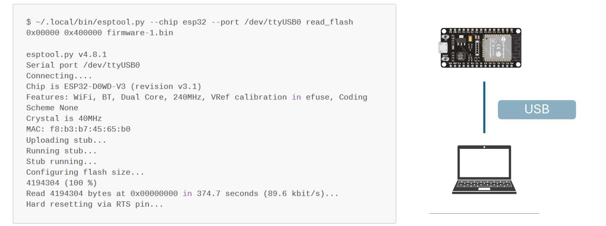{: width=500" .center}

Pour JTAG openocd avec le FT232H suffit largement. Des choses très amusantes peuvent être faites avec JTAG. Par exemple dumper la RAM de mon ESP32 pourtant avec flash encryption et récupérer des secrets mTLS... Je dis ça je dis rien...

https://github.com/openocd-org/openocd

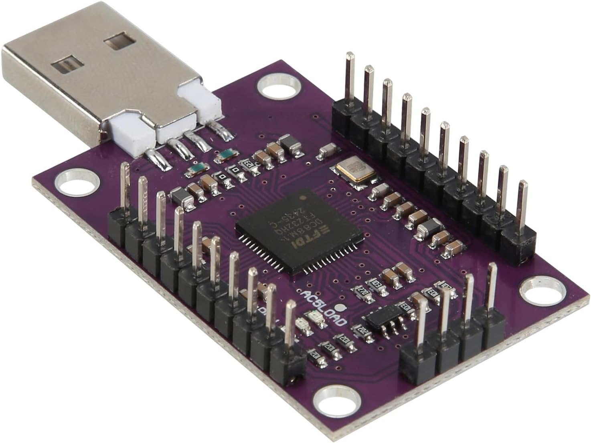{: width=500" .center}

L’idéal est donc d’activer a minima :
- le chiffrement de la flash (flash encryption) 
- le secure boot 
- la désactivation de JTAG via eFuse 
- si possible, la désactivation du download UART


**Coté PC**

Notre ESP32 envoie maintenant les IoP en MQTT. Côté PC, nous pouvons utiliser un client MQTT ou l’AWS IoT Device SDK v2 pour recevoir les paquets.

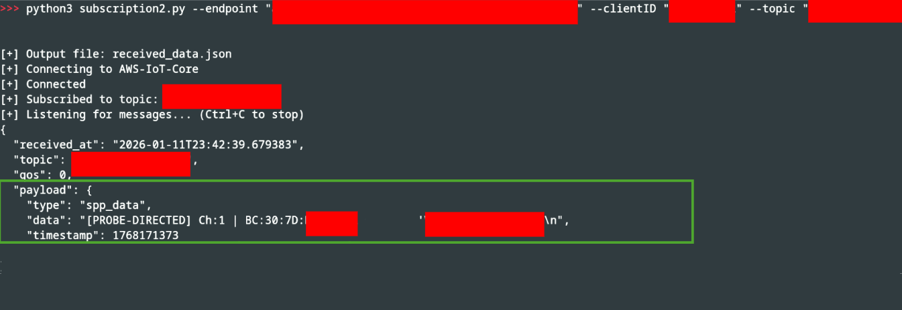{: width=500" .center}

**Un peu de bonne pratique**

Nous faisons de la cyber, donc autant configurer correctement les permissions et les policies AWS.
AWS IoT Core définit plusieurs actions de policy. Les quatre actions MQTT principales sont :
- **iot:Connect** : établir la session MQTT 
- **iot:Publish** : publier sur un topic 
- **iot:Subscribe** : s’abonner à un topic filter 
- **iot:Receive** : recevoir les messages d'un abonnement

Donc :
- **ESP32** : iot:Connect + iot:Publish 
- **PC** : iot:Connect + iot:Subscribe + iot:Receive 

Beaucoup de tutos ajoutent iot:* sur * « pour que ça marche ». C’est une mauvaise pratique : ça transforme un implant compromis en capacité de publication large, voire de subscription, alors qu’il n’en a pas besoin.

Très mauvais conseil à suivre sur cette chaine youtube

{: width=500" .center}

https://www.youtube.com/watch?v=59xppRDOEZE

Ce n'est pas la seule mauvaise ressource et les LLM font souvent la même chose si on ne lui précise pas les choses correctement (parfois même quand on lui demande)

L’idéal est d’avoir une identité par rôle :
- une identité pour l’ESP32, avec une policy publish-only + Connect
- une identité pour le PC, avec une policy subscribe + receive + Connect.

**Un peu de forensique**

Autre point à ne pas négliger...

Si vous utilisez l'IDE Arduino ou ESP-IDF (ce que je vous déconseille), l'ESP32 stocke vos credentials Wi-Fi dans la NVS **par défaut**. Le gros avantage (ou l'inconvénient, selon le point de vue), c'est que si vous changez de firmware ou de credentials Wi-Fi, les anciens restent sauvegardés tant que vous n'effacez pas entièrement la flash...

Une fois la flash extraite si vous utilisez esp-idf ou l'IDE Arduino, il sera très facile d'extraire la table des partitions et la nvs avec l'outil suivant:

https://github.com/BlackVS/esp32knife

On retrouve la table des partitions. Par defaut elle se trouve à l'offset 0x8000 quand on utilise esp-idf. Elle pourrait même être extraite à la main...

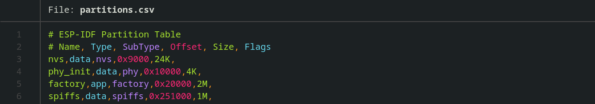{: width=500" .center}

Une fois la table des partitions en main, on peut extraire la NVS et aller chercher les credentials Wi-Fi qui sont stocké par défaut.

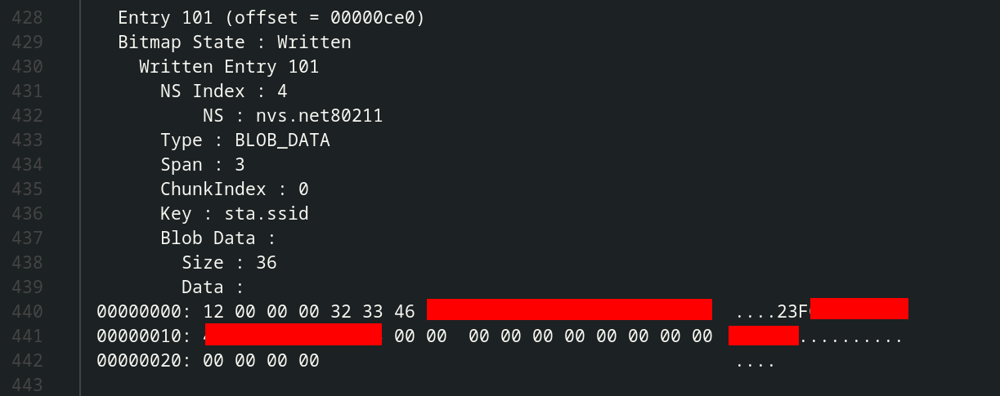{: width=500" .center}

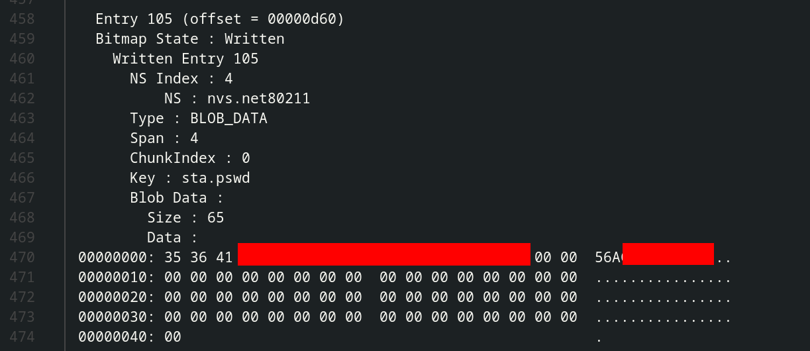{: width=500" .center}

Qui dit SSID Wi-Fi dit WiGLE, et il serait couillon que votre target trouve l'adresse où l'implant a été développé...

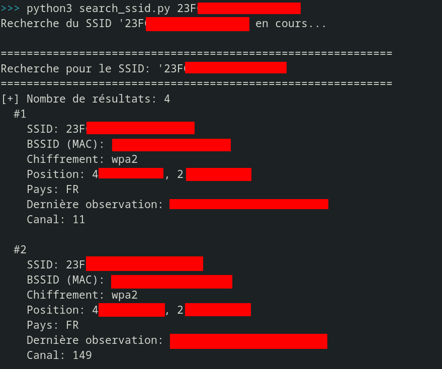{: width=500" .center}

Si malheureusement notre ESP32 est récupéré et que son nouveau propriétaire ou les forces de l'ordre arrivent à extraire les secrets, il pourra usurper l’identité de l’implant et publier de fausses données sur les topics autorisés. Cela peut devenir gênant.

Vous allez me dire s'il peut juste envoyer des fausses données pour faire échouer notre mission c'est déjà chiant et vous avez raison. Mais bon on fait de la cyber ici donc un mimima, je dis bien un minima de bonnes pratiques c'est mieux. Même si on peut rajouter beaucoup de choses...

## Conclusion

**Première question : peut-on savoir facilement si quelqu’un est à un endroit précis sans tracker GPS ?**

Oui. Avec une simple ESP32, quelques minutes sur place et le Wi-Fi activé sur le téléphone de la cible, on peut capter les directed probe. Si l’on repère un SSID propre à Toto (la box de chez lui, de son agence...) on obtient un indicateur de présence fort si l'on revoit les mêmes SSID dans des directed probe

Ce n’est pas une preuve absolue, car plusieurs appareils peuvent connaître le même SSID, mais cela suffit souvent pour savoir si notre target est passé par là.

**Deuxième question : peut-on retrouver son adresse en restant quelques minutes à côté de lui, sans OSINT ?**

C’est plus délicat. WiGLE peut donner parfois une adresse exacte mais souvent une localisation approximative et parfois du grand n'importe quoi. L'idéale est de garder uniquement les résultats les plus récents de WiGLE et idéalement avoir un historique qui pointe au même endroit